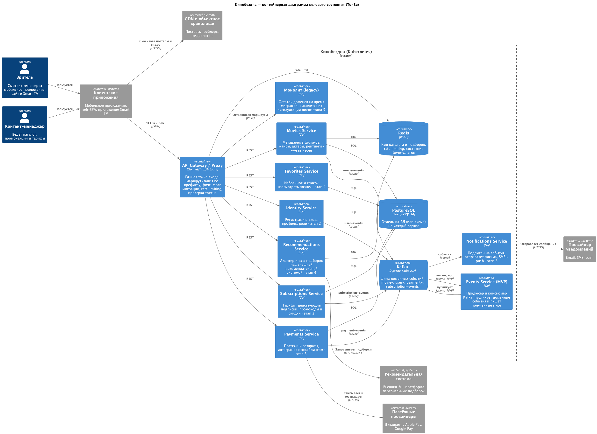

# Кинобездна: целевая архитектура (To-Be)

Контейнерная диаграмма в нотации C4 для целевого состояния системы после перехода
от монолита к доменным сервисам.



- Исходник PlantUML: [`c4-container.puml`](c4-container.puml)
- Векторная версия: [`c4-container.svg`](c4-container.svg)

---

## 1. Отправная точка и цель

**Как есть.** Один Go-монолит на PostgreSQL: пользователи, метаданные фильмов,
рейтинги, платежи, подписки, промокоды, избранное и сборка каталога живут в одном
процессе и одной схеме БД. Единственный вынесенный сервис — `movies`.

**Почему так дальше нельзя.** Домены с разным профилем нагрузки связаны в один
процесс и один релиз: всплеск на каталоге (витрина, трейлеры) роняет платежи,
изменение тарифа требует выката всего монолита, а масштабируется всё вместе.

**Что строим.** Целевое состояние — набор сервисов по доменам, единая точка входа
(API Gateway / Proxy) и асинхронная интеграция через Kafka для всего, где не нужен
немедленный ответ. Переход — по паттерну **Strangler Fig**: монолит не переписывается
целиком, домены вынимаются по одному и трафик переключается фиче-флагом.

---

## 2. Домены и их ответственность

| Домен | Сервис | Ответственность | Этап миграции |
|---|---|---|---|
| Каталог | **Movies Service** | Метаданные фильмов, жанры, актёры, рейтинги | уже вынесен |
| Идентификация | **Identity Service** | Регистрация, вход, профиль, роли, сессии | 2 |
| Подписки и промо | **Subscriptions Service** | Тарифы, действующие подписки, промокоды и скидки | 3 |
| Платежи | **Payments Service** | Списания, возвраты, интеграция с эквайрингом | 3 |
| Избранное | **Favorites Service** | Избранное и «посмотреть позже» *(API появится на этапе 4)* | 4 |
| Рекомендации | **Recommendations Service** | Адаптер и кэш подборок над внешней рекомендательной системой | 4 |
| Уведомления | **Notifications Service** | Email, SMS, push по событиям шины | 5 |
| Легаси | **Монолит** | Всё, что ещё не вынесено; выводится из эксплуатации после этапа 5 | — |

Разбиение выбрано по бизнес-возможностям, а не по техническим слоям: у каждого
домена свой владелец данных, свой жизненный цикл изменений и своя нагрузка.
`payload`-домены (каталог, рекомендации) можно масштабировать и кэшировать
независимо от `transaction`-доменов (платежи, подписки).

---

## 3. Единая точка вызова: API Gateway / Proxy

Все клиенты (мобильное приложение, веб-SPA, Smart TV) ходят только в шлюз — ни один
клиент не знает адресов внутренних сервисов.

Шлюз отвечает за:

- **Маршрутизацию по префиксу** — таблица ниже;
- **Фиче-флаг миграции** — для домена, который уже реализован в новом сервисе,
  задаётся процент трафика (`MOVIES_MIGRATION_PERCENT`), остаток уходит в монолит;
- **Rate limiting** и защиту от всплесков;
- **Проверку токена** до попадания запроса в домен — так авторизация остаётся в
  одном месте, пока её владелец (Identity) не станет единственным потребителем.

| Маршрут | Целевой сервис | Сейчас |
|---|---|---|
| `GET/POST /api/movies` | Movies Service | Монолит → 50% в Movies Service (флаг) |
| `GET/POST /api/users` | Identity Service | Монолит |
| `GET/POST /api/payments` | Payments Service | Монолит |
| `GET/POST /api/subscriptions` | Subscriptions Service | Монолит |
| `POST /api/events/{movie,user,payment}` | Events Service | Events Service (MVP) |
| `/health`, `/api/*/health` | Пробрасывается в целевой сервис | — |

---

## 4. Интеграционное взаимодействие

Два канала, и выбор между ними осознанный.

**Синхронно (REST)** — только там, где клиенту нужен ответ в том же запросе:
список фильмов, карточка фильма, создание платежа, проверка подписки при старте
воспроизведения.

**Асинхронно (Kafka)** — всё, что является *фактом о произошедшем*: пользователь
зарегистрировался, фильм просмотрен или оценён, платёж прошёл или отклонён,
подписка оформлена. Топики: `movie-events`, `user-events`, `payment-events`
(и `subscription-events` в планах).

Что это даёт:

- Сервис-источник не ждёт потребителей и не знает о них — новый потребитель
  (аналитика, антифрод, нотификации) подключается без изменений в источнике;
- Всплеск событий буферизуется в Kafka, а не превращается в очередь на ретраи в
  синхронном вызове;
- Отказ потребителя не ломает основной сценарий: пользователь всё равно платит и
  смотрит.

**Events Service (MVP).** Показывает, что шина действительно проста: вызов
`POST /api/events/{тип}` публикует событие в топик, этот же сервис его читает и
пишет в лог. В целевом состоянии место MVP занимают полноценные продюсеры в
доменах и потребители вроде Notifications.

---

## 5. Данные

**Database per service.** У каждого домена своя БД (на переходном этапе — отдельная
схема в общей инсталляции PostgreSQL, затем отдельные инстансы). Сервис не читает
чужие таблицы: только через API или события. Это цена независимых релизов, и её
платим сразу — иначе «микросервисы» остаются распределённым монолитом.

Redis — поперечный кэш: каталог и подборки, состояние rate limiting, фиче-флаги.

---

## 6. План миграции (Strangler Fig)

| Этап | Что делаем | Как проверяем |
|---|---|---|
| 0 | Шлюз перед монолитом, 0% трафика в новые сервисы | Все тесты зелёные, поведение не изменилось |
| 1 | `movies` за шлюзом, доля трафика растёт 10 → 50 → 100% | Сравнение ответов монолита и сервиса, метрики ошибок |
| 2 | Identity Service, монолит читает пользователей через API | Вход, регистрация, профиль |
| 3 | Subscriptions и Payments — домены с деньгами, переключаются вместе | Сквозной сценарий оплаты, сверка в БД |
| 4 | Favorites, Recommendations | Избранное, выдача подборок |
| 5 | Notifications на событиях шины, вывод монолита | Событийные сценарии, затем гасим монолит |

Ключевое правило: **процент трафика — единственный рубильник**. Откат любого этапа —
вернуть флаг в 0, без релиза.

---

## 7. Нефункциональные требования

- **Платформа** — Kubernetes: независимое масштабирование подов по домену, rolling-обновления.
- **CI/CD** — GitHub Actions: сборка образов в GHCR, Postman-тесты на каждом пуше.
- **Надёжность** — Istio: Circuit Breaker для монолита и `movies`, канареечный деплой.
- **Производительность** — CDN и объектное хранилище под постеры и видеопоток,
  кэш каталога в Redis.
- **Наблюдаемость** — трассировка запроса через шлюз и домены, метрики шины по
  лагу потребителей.

---

## 8. Как пересобрать диаграмму

```bash
# нужен Java и plantuml.jar (C4-библиотека входит в стандартную поставку)
java -jar plantuml.jar -tpng -charset UTF-8 docs/architecture/c4-container.puml
java -jar plantuml.jar -tsvg -charset UTF-8 docs/architecture/c4-container.puml
```

PlantUML назовёт файлы по имени диаграммы (`C4_Container_ToBe.*`) — переименуйте
в `c4-container.png` / `c4-container.svg`.
